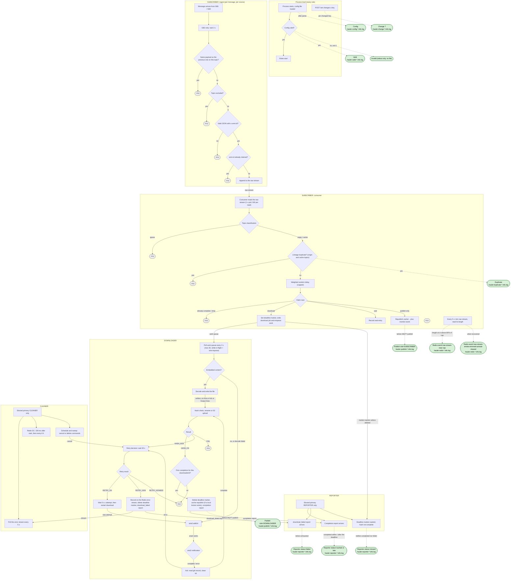
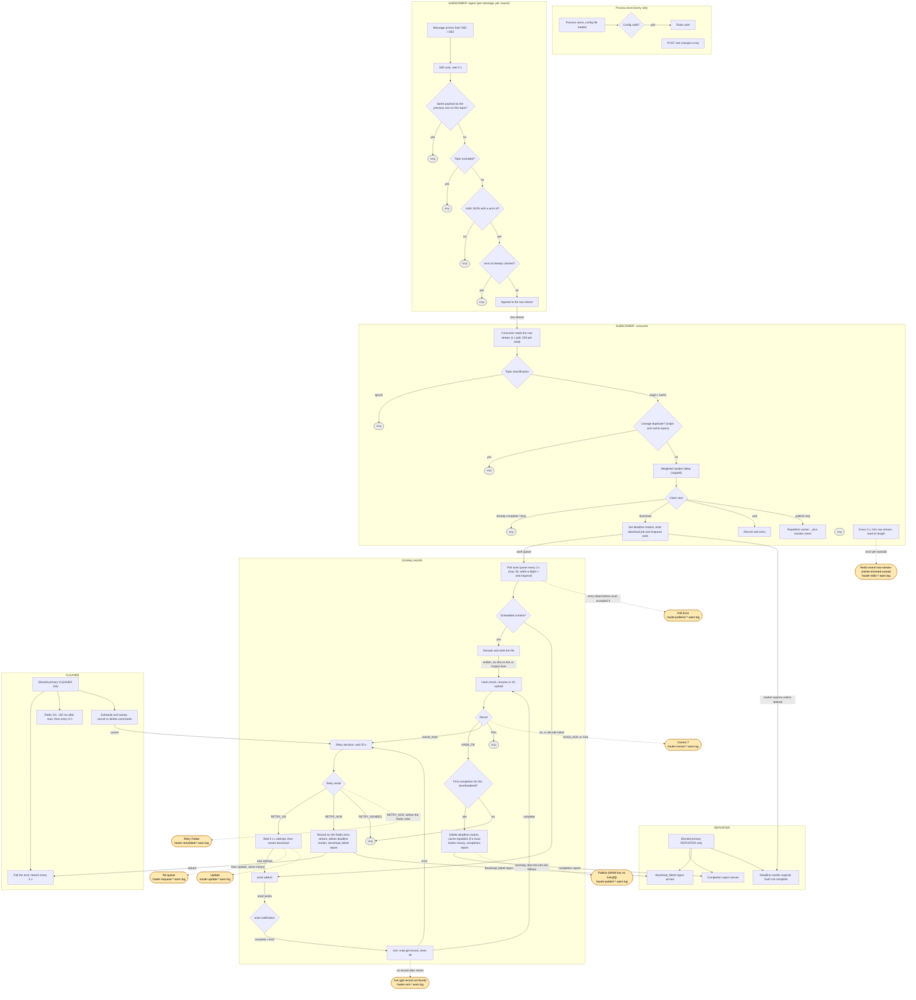
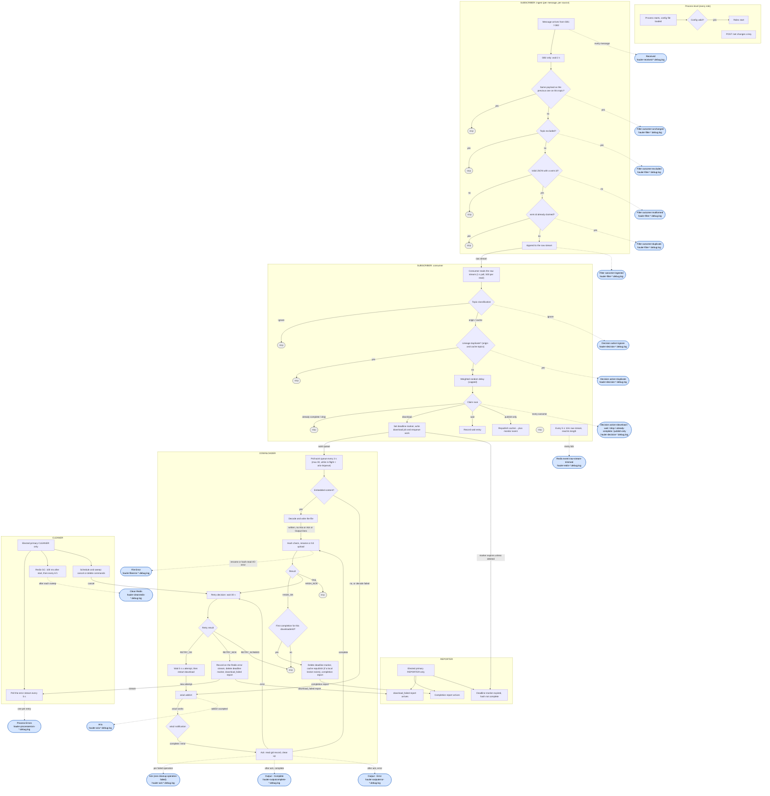

# Logging reference

What wis2hauler logs, for every role and every log level, which file each log goes to, and in what order entries appear.

> **Scope.** Based on `src/logging/*`, `src/main.ts`, every `run.ts`, and the subscriber/downloader/cleaner modules that emit logs. File names, line format, rotation naming and ordering of rotated parts were checked by running the real `winston` + `winston-daily-rotate-file` versions from `node_modules`. Anything not verified that way is marked *(unverified)*.

---

## 1. How logging works

Every log entry is one JSON line written by a named logger through a single sink. `global.log.to` (`stdout` or `file`, fixed at startup) only chooses where the line goes; what is written and how the level is applied are identical either way.

| Logger family | What it covers | Level | Format |
|---|---|---|---|
| **Pipeline loggers** | One named logger per processing stage (`Received`, `Filter`, `Decision`, `Aria`, `Ack`, …), tagged `info`, `warn` or `debug` per call | Written according to `global.log.level` (§2.2) | JSON line, stage-specific fields |
| **Process loggers** | Operational messages: starting, stopping, a role failing, aria2 or a broker unreachable, per-message failures (§5.6) | Always written (`info`) | JSON line with `severity` (`info`, `warn`, `error`) and `message` |

Process loggers are written at `info`, which every configured level admits, so these messages are present in every configuration.

The only output outside this sink is what is printed before the config is loaded (usage error, `config invalid: …`, followed by the `Invalid` line) and the process entrypoint's last-resort fatal handler and shutdown-timeout message.

---

## 2. Configuration and runtime control

### 2.1 `global.log`

```yaml
global:
  log:
    level: info      # required: info | warn | debug
    to: file         # optional: stdout (default) | file — never both
    size: 200        # optional: MB per file, default 200 (plain number)
    number: 25       # optional: max files kept per (level, source) logger, default 25
    dir: ./logs      # optional: only with to: file, default ./logs
```

At startup `validate.ts` reports one info message, e.g. `config: global.log: level=debug, to=file, size=200MB, number=25` (logger `Main Process`, §5.6).

`to`, `size`, `number` and `dir` are read **once** when the sink is built. Only the *level* can change at runtime.

### 2.2 Level semantics — a verbosity ladder, not a severity threshold

Every structured call is tagged `info`, `warn` or `debug`. A call is written when `rank(call) <= rank(configured level)`, with `info=0, warn=1, debug=2`:

| Configured level | `info`-tagged calls | `warn`-tagged calls | `debug`-tagged calls |
|---|---|---|---|
| `info` | written | – | – |
| `warn` | written | written | – |
| `debug` | written | written | written |

Consequences:

- **`info`-tagged logs can never be switched off** — every level admits them.
- `warn` is *more* verbose than `info`, not a filter on top of it.
- A file for a (logger, level) pair is created lazily on its first write. At `info` there are no `*.warn.log` or `*.debug.log` files at all.

### 2.3 Per-role override

Each structured logger is bound to a role (or to none). The effective level is the per-role override if one is set, otherwise the global level. Process-level loggers (`Config`, `Valid`, `Change ?`, `Main Process`, `Admin Process`, `Heartbeat Process`) have no role and only ever see the global level.

Read and change at runtime (default admin port `8080`; images without `curl` can use `wget`):

```bash
curl -s 'http://localhost:8080/get?key=log-level'
curl -s 'http://localhost:8080/get?key=log-level-role'
curl -s -X POST http://localhost:8080/set -d '{"log-level":"debug"}'
curl -s -X POST http://localhost:8080/set -d '{"log-level-role":{"role":"SUBSCRIBER","value":"debug"}}'
curl -s -X POST http://localhost:8080/set -d '{"log-level-role":{"role":"SUBSCRIBER","value":null}}'
```

```bash
wget -qO- --header='Content-Type: application/json' --post-data='{"log-level-role":{"role":"DOWNLOADER","value":"debug"}}' http://localhost:8080/set
```

`value: null` clears the override. Valid roles are `SUBSCRIBER, DOWNLOADER, CLEANER, REPORTER, REPLAYER`; overriding REPORTER or REPLAYER is accepted but has no effect (their loggers are written at `info`, which no level filters out). Overrides are per process and are lost at restart.

Every successful change is itself logged (`Change ?`, see §5.1).

---

## 3. Line format

Each structured entry is one JSON object on one line:

```json
{"action":"download","data_id":"20261024T0750Z_AAXX_07156","downloader_id":"3f1c…","href":"https://…/x.bufr4","level":"debug","logger":"decision","pubtime":"2026-10-24T07:50:02Z","timestamp":"2026-10-24T07:50:03.412Z","topic":"origin/a/wis2/fr-meteofrance/data/core/weather/surface-based-observations/synop","wnm_id":"b7a0…"}
```

- Keys are **alphabetically sorted** (winston's JSON serializer), so field order never reflects the order they were built in.
- `timestamp` is ISO-8601 **UTC**, millisecond precision, taken when the entry is written (not when the underlying event happened).
- `level` is added by winston.
- `worker` is this process's `global.worker`, on every line, so lines stay attributable after being centralized (e.g. by Vector) without parsing file paths. Lines written before `global.log` exists (`Invalid`) have none.
- Fields whose value is `undefined` are simply absent.
- `logger` is the logger's slug (`filter`, `decision`, `outputerror`, …), the same string used in the filename, so lines stay identifiable on `to: stdout` and after being copied out of their file. It is deliberately not called `source`: `Received` and `Filter` already use `source` for `GB1`/`GB2`.

With `to: stdout` entries go to stdout as the same JSON.

---

## 4. Files, naming and rotation

### 4.1 File name

```
hauler-<slug>-YYYY-MM-DD-HH.<level>.log
```

- `<slug>`: the logger name lowercased with every non `a-z` character removed (`Re-queue` → `requeue`, `Correct ?` → `correct`, `Output - Error` → `outputerror`).
- `<level>`: the level of the **call**, so one logger can produce several files (`hauler-redis-….debug.log`, `….info.log`, `….warn.log`).
- `YYYY-MM-DD-HH` is an **hourly bucket in the process's local time** (verified: `TZ=Asia/Tokyo` produced hour 16 while UTC was 07). The `timestamp` field inside is always UTC. Run the containers with `TZ=UTC`, otherwise file hours and entry timestamps disagree — and `Tracer/src/logs.ts` interprets the hour as UTC.
- Files live in `global.log.dir` (default `./logs`), created if missing. Deployments with one directory per worker keep each worker's logs separate.

### 4.2 Rotation

| Trigger | Result (verified) |
|---|---|
| New hour | New file `…-HH.<level>.log`; the previous hour's file is gzip-archived (`….log.gz`) |
| File exceeds `size` MB | Continues in `….log.1`, then `.2`, `.3`… of the same hour; archived parts become `….log.1.gz`, `….log.2.gz`, … (naming per `Tracer/src/logs.ts`; the `.N` part naming itself was verified) |
| More than `number` files | Oldest files removed *(retention not verified; see below)* |

A hidden `.<hash>-audit.json` file per logger sits in the log directory — ignore it.

**Retention.** `number` is a file count per (level, source) logger. Since files are hourly, 25 files is on the order of a day of history for a logger that writes every hour. If you need longer history for an investigation, raise `number` before the incident. Whether size-rotated parts count against the same limit was not tested.

### 4.3 Order inside a rotated hour

Chronological from the base file upward: `…log` (oldest) → `.1` → `.2` → … (newest). Verified with 60 sequentially numbered entries: the base file held entries 0–6, `.1` held 7–13, and so on.

---

## 5. Catalogue of structured loggers

Legend — **Level** is the tag of the call (the minimum configured level that writes it).

### 5.1 Process-level (every role, `main.ts`)

| Logger | File | Level | Fires | Fields |
|---|---|---|---|---|
| `Config` | `hauler-config-*.info.log` | info | Once at startup, after the config file is parsed | `path`, `worker`, `roles` |
| `Valid` | `hauler-valid-*.info.log` | info | Once at startup, config validated | `path`, `warnings` (count) |
| `Change ?` | `hauler-change-*.info.log` | info | Once per key actually changed by `POST /set` (`changed: true` only) | `key`, `value` |
| `Invalid` | **stdout only**, never a file | info | Config failed validation, then exit code 1 | `path`, `errors` (count), `warnings` (count) |

`Change ?` values: full lists for `subscribe`/`exclude`/`override`, `{role,value}` for `log-level-role`. For `credentials` only `{op, topic, username}` is logged — **the password is never written**.

### 5.2 SUBSCRIBER

Role-bound loggers: `Received`, `Filter`, `Decision`, `Duplicate`, `Publish`, `Redis`. They follow `log-level-role` for `SUBSCRIBER`.

| Logger | File | Level | Fires | Fields |
|---|---|---|---|---|
| `Received` | `hauler-received-*.debug.log` | debug | **Every** message from GB1/GB2, before the GB2 2 s pre-delay and before any filter | `source` (GB1/GB2), `topic`, `bytes`, `wnm_id`, `data_id` |
| `Filter` | `hauler-filter-*.debug.log` | debug | Once per message per ingest outcome (below) | `source`, `topic`, `wnm_id`, `data_id`, `outcome`, `wnm`, plus `error` for `malformed` |
| `Decision` | `hauler-decision-*.debug.log` | debug | Exactly once per parsed stream entry (every outcome, including `ignore` and lineage `duplicate`) | see below |
| `Duplicate` | `hauler-duplicate-*.info.log` | **info** | A lineage duplicate was detected | `topic`, `data_id`, `wnm_id`, `pubtime`, `reason`, and `originCentreId` (origin topics) or `globalCache` (cache topics) |
| `Publish` | `hauler-publish-*.info.log` | **info** | `publish-only` outcome with at least one local broker (PUB1/PUB2) | `downloader_id`, `role: "SUBSCRIBER"`, `topic` (the `cache/…` topic), `wnm` (the republished WNM); when a monitoring event is also emitted, `monitorTopic` and `monitor` |
| `Redis` | `hauler-redis-*.debug.log`, `.info.log`, `.warn.log` | debug / info / warn | Raw-stream health check (below) | `queue`, `event`, plus event-specific fields |

**`Received` details**
- At `debug` (the only level it is written at) `wnm_id` and `data_id` are populated whenever the payload is valid JSON. If it is not, they are absent and `bytes` is the raw payload length.
- `bytes` for a parsed payload is the UTF-8 size of the *canonical* content (keys sorted, no whitespace), so the same `wnm.id` always shows the same size even if two upstream brokers format the JSON differently.

**`Filter` outcomes** (in the order the handler tests them)

| `outcome` | Meaning |
|---|---|
| `unchanged` | Payload byte-identical to the previous one on the same topic **on the same connection** (rbe). In-memory, reset at restart. |
| `excluded` | Topic (replay prefix stripped) matches the effective exclude list: the configured exclude list plus the recommended-topic rule if `global-cache` is on, or the origin core + metadata rules if it is off. |
| `malformed` | JSON parse failure or missing/empty `wnm.id`. |
| `duplicate` | `wnm.id` already claimed in Redis (900 s TTL) — typically the same notification arriving from both GB1 and GB2. |
| `ingested` | New message appended to the raw stream; this is the only outcome that reaches the consumer. |

`wnm` is the whole parsed notification. It is absent when the payload was not parseable at all. The record is large; expect `Filter` and `Received` to dominate disk use at `debug`.

**`Decision` fields and actions**
- Always: `data_id`, `wnm_id`, `topic`, `pubtime`, `action`.
- For `action: "ignore"`: plus `reason` — one of
  1. `origin resolved to weight 0 (missing from weight-sources, or explicitly weighted 0)`
  2. `cache topic has no (string) global-cache property to classify by`
  3. `source '<centre>' resolved to weight 0 (missing from weight-sources, or explicitly weighted 0)`
  4. `topic matches neither origin/a/wis2 nor cache/a/wis2`
- For `action: "duplicate"` (lineage duplicate): plus `reason`, the same text as the matching `Duplicate` line (below). No `downloader_id`/`href`: the entry stops before they are computed.
- For every other action: plus `downloader_id` and `href` (first link).

| `action` | Meaning |
|---|---|
| `already-complete` | This `downloader_id` is already fully cached — nothing to do. |
| `download` | This replica won the claim; a download job is written and queued for DOWNLOADER. |
| `wait` | Another replica holds the claim and `nocache` is not set; a wait entry is recorded as a fallback source. |
| `drop` | Lost the claim and `nocache` is set; nothing to do. |
| `publish-only` | Won the claim, `global-cache` is on and `nocache` is set: republish under `cache/…` plus a monitoring event, no download. |
| `ignore` | Classification rejected the topic (see `reason`). |
| `duplicate` | Lineage duplicate: `data_id` reused without `rel=update` or without a newer `pubtime` (see `reason`). Also written to `Duplicate` (info). |

The `Decision` line is written **before** the Redis writes for that action. If those writes then fail, a process error follows (`consumer: failed processing …`) — a `download` line alone does not prove the job was queued.

**`Duplicate` reasons**
- `pubtime is not newer than a previously seen publish for this data_id`
- `newer pubtime but rel is not "update" -- data_id reuse requires rel=update per the WIS2 spec`

Only origin topics and cache topics carrying a string `global-cache` are checked. A message logged here stops right there, and its `Decision` line (`action: duplicate`) is written at the same moment, so the `Duplicate` and `Decision` lines for one message carry the same `reason`.

**`Redis` events** (checked every 5 s by the consumer loop)

| File | `event` | Condition |
|---|---|---|
| `.debug.log` | `raw-stream-trimmed` (`length`) | Every check, after `XTRIM … MINID ~ <read cursor − 15 min>` |
| `.info.log` | `raw-stream-near-cap` (`length`, `warnAtLength`) | Every check where the post-trim length is ≥ 80 % of `RAW_STREAM_MAXLEN` (500 000 → 400 000) |
| `.warn.log` | `raw-stream-entries-trimmed-unread` (`lastId`, `oldestSurvivingId`) | Once per episode: the oldest surviving entry has overtaken the consumer's cursor (confirmed loss) |
| `.info.log` | `raw-stream-entries-trimmed-unread-cleared` (`lastId`) | The loss condition has cleared |

The loss check only starts after the consumer has read at least one entry. A failed trim or check goes to the process log (`Subscriber Process`), and that tick writes no `Redis` line.

### 5.3 DOWNLOADER

All role-bound to `DOWNLOADER`. Most lines carry `data_id` and `downloader_id`, the keys to follow a download from SUBSCRIBER's `Decision` line to completion.

| Logger | File | Level | Fires | Fields |
|---|---|---|---|---|
| `Aria` | `hauler-aria-*.debug.log` | debug | aria2 accepted a **real** download (`addUri` returned a gid), including retries | `data_id`, `downloader_id`, `href`, `filename`, `gid`, `hasCredentials` |
| `Output - Complete` | `hauler-outputcomplete-*.debug.log` | debug | aria2 reported completion and the file is under `aria-download`. Written **after** the ack, once per notification. | `gid`, `status`, `data_id`, `downloader_id` |
| `Output - Error` | `hauler-outputerror-*.debug.log` | debug | aria2 reported an error. Written **after** the ack. | `gid`, `status`, `errorCode`, `errorMessage`, `data_id`, `downloader_id` |
| `Ack` | `hauler-ack-*.warn.log` | warn | No usable `aria2_gid` record found after retrying (waits of 100 ms then 300 ms) — the completion/error is abandoned | `worker`, `gid`, `retries`, `reason` |
| `Ack` | `hauler-ack-*.debug.log` | debug | One of the five ack cleanup operations rejected (one line per failure) | `worker`, `gid`, `streamId`, `data_id`, `error` |
| `Correct ?` | `hauler-correct-*.warn.log` | warn | Hash/rename step ended in a non-OK outcome | `downloader_id`, `data_id`, `hashOutcome`, `hashDetail` |
| `File Error` | `hauler-fileerror-*.debug.log` | debug | Rename/move or hash read raised an I/O error | `downloader_id`, `data_id`, `filepath`, `error` |
| `Publish` | `hauler-publish-*.info.log` | **info** | File completed and hash OK, and this was the first completion for the `downloader_id`, with ≥ 1 local broker | `downloader_id`, `role: "DOWNLOADER"`, `topic` (`cache/…`), `link` (local href), `wnm` |
| `Publish` | `hauler-publish-*.warn.log` | warn | The WNM has no `links[0]` (anomaly) — immediately followed by the `.info.log` line | `downloader_id`, `role`, `wnmTopic`, `href` |
| `Re-queue` | `hauler-requeue-*.warn.log` | warn | A retry is about to start | `downloader_id`, `data_id`, `href` (the alternate source), `topic` |
| `Update` | `hauler-update-*.warn.log` | warn | Same instant as `Re-queue`: the retry's bookkeeping transition | `downloader_id`, `data_id`, `promoteHref`, `newAttempt` |
| `Retry Failed` | `hauler-retryfailed-*.warn.log` | warn | The retry decision ended in `RETRY_NOK`: no alternate source, attempt counter exhausted, `error-nocache` set, or the Redis record already gone. The failure is then also recorded on the error stream. Written before that Redis write. | `downloader_id`, `data_id`, `hashFound` (`false` = the record had already vanished) |
| `Poll Error` | `hauler-pollerror-*.warn.log` | warn | A work-queue entry failed before aria2 accepted it (aria2 unreachable, `addUri` rejected, …) | `downloader_id`, `data_id`, `href`, `error` |

Notes:
- `hashOutcome` is `HASH_NOK` or `FAIL`. `hashDetail` is `digest-mismatch` or `unsupported-method` for `HASH_NOK`, and absent for `FAIL` and for `HASH_NOK` caused by an I/O error. After `HASH_NOK` a retry decision follows; after `FAIL` nothing more happens.
- `Publish` in `DOWNLOADER` and `SUBSCRIBER` is the same slug, so **both roles write to the same `hauler-publish-*.info.log`** (if in the same process/directory). Tell them apart by `role`.
- `File Error` (DOWNLOADER, debug, file-rename/hash I/O error) is unrelated to `Duplicate` (SUBSCRIBER, info, data_id lineage).
- `Publish` is written **before** the MQTT publish. A failed publish shows as a `Downloader Process` error `DOWNLOADER: Finishing (<id>): step 1/4 cache republish failed, continuing with steps 2-4: …`.
- Retries: `Re-queue`/`Update` only appear when an alternate source (a recorded `wait` href) exists, the attempt counter is ≤ 6, and no `error-nocache` flag is set. When retries are exhausted DOWNLOADER writes `Retry Failed` (warn) and also pushes the failure onto a Redis error stream, which the primary CLEANER echoes as `Process Errors` at debug (§5.4).
- `data_id`/`downloader_id` on `Output - *` come from the gid's Redis record, read by the ack. If that record is gone (the `Ack` warn case), the line is still written, with only `gid` and `status` (plus aria2's error fields).
- Downloads completed from embedded WNM content (`properties.content`) skip aria2: they produce **no `Aria`, `Output - Complete` or `Output - Error` lines**, only (on success) `Publish`.
- A download cancelled by CLEANER (stalled) goes through the ack path with **no `Ack` logger attached**, so ack problems there are silent.

### 5.4 CLEANER

Role-bound to `CLEANER`. Only the **elected primary** CLEANER runs these loops, so only that instance writes the files; secondaries write none.

| Logger | File | Level | Fires | Fields |
|---|---|---|---|---|
| `Process Errors` | `hauler-processerrors-*.debug.log` | debug | One line per entry read from the error stream `wis2gc:error:<queue>:<worker>`; polled every 5 s | `entryId`, `payload` |
| `Clean Redis` | `hauler-cleanredis-*.debug.log` | debug | After each Redis garbage-collection sweep: first 100 ms after start, then every 6 h | `totalDeleted`, `errors` |

- `payload` for DOWNLOADER retry-exhaustion errors is `{downloader_id, data_id, hashFound, hash}`, where `hash` is the Redis record as a flat array.
- The key includes the worker name, and CLEANER reads its **own** worker's error stream. A CLEANER only sees errors from the DOWNLOADER with the same `global.worker`.
- At `info` or `warn`, CLEANER writes no `Process Errors`/`Clean Redis` files. Its operational messages (starting, failures) are in `hauler-cleanerprocess-*.info.log` (§5.6).

### 5.5 REPORTER, REPLAYER, HEARTBEAT

REPLAYER and HEARTBEAT have no pipeline loggers; they only write process messages (§5.6): `hauler-replayerprocess-*`, `hauler-heartbeatprocess-*`.

REPORTER has one pipeline logger, role-bound to `REPORTER` and written only by the **elected primary**:

| Logger | File | Level | Fires | Fields |
|---|---|---|---|---|
| `Reporter` | `hauler-reporter-*.info.log` | info | Once per notification SUBSCRIBER accepted for download, with the outcome in `status` | `status`, `data_id`, `downloader_id`, `wnm_id`, `pubtime`, `topic`, `href`, `acceptedAt`, `wnm`, plus the status-specific fields below |

`status` values:

| `status` | When it is written | Status-specific fields |
|---|---|---|
| `cached` | The download completed within the deadline. Written at completion. | `cachedAt`, `latencyMs`, `length` |
| `late` | The download completed after the deadline (completion − `acceptedAt` > deadline). Written at completion. | `cachedAt`, `latencyMs`, `length`, `deadlineMs` |
| `failed` | Retries are exhausted (integrity failure or download error). The final outcome, written immediately. | `failedAt`, `reason` (`integrity` or `download_error`), `attempt` |
| `missed` | The deadline passed with the download neither completed nor failed. | `deadlineMs`, `attempt` where known |

- `wnm` is the full initial WNM as received, without the internal `downloader_id` field. `acceptedAt`, `cachedAt` and `failedAt` are epoch milliseconds.
- The deadline is `global.cache-deadline` (seconds, default 600). SUBSCRIBER sets a TTL marker `wis2gc:marker:<downloader_id>` when it accepts a notification; DOWNLOADER deletes it on completion or retry exhaustion. If the marker expires, Redis publishes an expiry event and the REPORTER writes `missed` after reading the record.
- A download that completes after its `missed` line produces a second line, `late`. Per `downloader_id`, the last line wins.
- The `FAIL` hash outcome (S3 failure, rename collision) is not retried, so its marker expires and the notification is reported as `missed`.
- `data_id` is the key to follow: one `Reporter` line per accepted notification gives the answer to "was it cached in time". A `data_id` with no `cached` or `late` line after the deadline is a gap to investigate.

Example (keys are alphabetical in the file):

```json
{"acceptedAt":1790000000123,"cachedAt":1790000004567,"data_id":"origin/a/wis2/fr-meteofrance/data/core/weather/surface-based-observations/synop/20261024T1900_0001.bufr4","downloader_id":"…","latencyMs":4444,"length":18342,"level":"info","logger":"Reporter","status":"cached","timestamp":"2026-10-24T19:00:04.570Z","topic":"origin/a/wis2/fr-meteofrance/data/core/weather/surface-based-observations/synop","wnm":{"…":"full initial WNM"},"wnm_id":"…","worker":"…"}
```

Notes:

- **Expiry events are best-effort.** Redis `notify-keyspace-events` must include `Ex`; the REPORTER merges `E` and `x` with `CONFIG SET` at start and warns in `Reporter Process` if that is not allowed. The setting is applied again each time a Redis connection is re-established (restart, failover). Events are not stored: during a REPORTER failover (about 10–18 s without a primary) expiries are not reported. In a Redis Cluster each node publishes its own events; the REPORTER subscribes to every node known at start, so nodes added later are not covered until restart.
- **Volume.** Each line carries the full WNM, roughly 150–300 MB/hour at about 100 000 notifications/hour. Size `global.log.size` and `global.log.number` accordingly, since size rotation applies (§4.2).

### 5.6 Process loggers (all roles)

Every operational message (start/stop, failures, connectivity) goes through one of these loggers, so it follows `global.log.to` like everything else. All are written at **info** (always present at any configured level). `severity` is `info`, `warn` or `error`.

| Logger | File | Level | Fires | Fields |
|---|---|---|---|---|
| `Main Process` | `hauler-mainprocess-*.info.log` | info | Config warnings/infos, process starting, HTTP admin listening, orchestrator connecting to PUBn/GBn, local-broker unreachable | `severity`, `message` |
| `Subscriber Process` | `hauler-subscriberprocess-*.info.log` | info | SUBSCRIBER role start/stop/failure, GBn subscribed, consumer start, ingest/consumer errors (malformed WNM, XREAD/trim/oldest-id failures, publish-only publish failures) | `severity`, `message`, plus `data_id`, `wnm_id`, `downloader_id`, `topic`, `entryId`, `source` where known |
| `Downloader Process` | `hauler-downloaderprocess-*.info.log` | info | DOWNLOADER role start/stop/failure, aria2 connected/disconnected/errors, consumer-group and poll failures, per-entry failures, retry-decision failures, credential sync/parse problems, finishing-step failures | `severity`, `message`, plus `data_id`, `downloader_id`, `entryId`, `href` where known |
| `Cleaner Process` | `hauler-cleanerprocess-*.info.log` | info | CLEANER start/stop/failure, Schedule/Sweep/Poll Errors/Clean Redis failures, `Clean Redis deleted N keys` (N > 0), election poll failures | `severity`, `message` |
| `Reporter Process` | `hauler-reporterprocess-*.info.log` | info | REPORTER start/stop/failure, report processing, Metrics tick, Caddy webhook failures, election poll failures | `severity`, `message` |
| `Replayer Process` | `hauler-replayerprocess-*.info.log` | info | REPLAYER start/stop/failure, replay trigger failures, election poll failures | `severity`, `message` |
| `Heartbeat Process` | `hauler-heartbeatprocess-*.info.log` | info | Heartbeat start/stop/failure, heartbeat write failures | `severity`, `message` |
| `Admin Process` | `hauler-adminprocess-*.info.log` | info | `ADMIN:` warnings (e.g. a failed credentials operation) | `severity`, `message` |

- A message with a trailing structured payload carries those fields at top level, so per-message failures group by `data_id` with the rest of the trace.
- Process loggers pass the role to the gate, but because they are `info` they are never filtered out.

---

## 6. What each role logs at each level

### 6.1 Files produced by configured level

Cumulative: each column includes everything to its left. "*(role)*" restricts a row to that role's override.

| Role | `info` | adds at `warn` | adds at `debug` |
|---|---|---|---|
| Process-level | `config`, `valid`, `change`, `mainprocess`, `adminprocess`, `heartbeatprocess` | – | – |
| SUBSCRIBER | `duplicate.info`, `publish.info`, `redis.info`, `subscriberprocess` | `redis.warn` | `received`, `filter`, `decision`, `redis.debug` |
| DOWNLOADER | `publish.info`, `downloaderprocess` | `publish.warn`, `ack.warn`, `correct`, `requeue`, `update`, `retryfailed`, `pollerror` | `aria`, `outputcomplete`, `outputerror`, `ack.debug`, `fileerror` |
| CLEANER | `cleanerprocess` | – | `processerrors`, `cleanredis` |
| REPORTER | `reporter`, `reporterprocess` | – | – |
| REPLAYER | `replayerprocess` | – | – |

(File names abbreviated: `received` = `hauler-received-<date-hour>.debug.log`, `redis.warn` = `hauler-redis-<date-hour>.warn.log`, and so on.)

What the `info` column means in practice: with the default `info`, SUBSCRIBER writes only lineage duplicates, publish-only republishes and Redis near-cap notices; DOWNLOADER only successful cache republishes; the primary REPORTER one `Reporter` outcome line per accepted notification. The per-message trace (`Received`/`Filter`/`Decision`/`Aria`) needs `debug`.

### 6.2 Process messages and what is still plain console

Process messages are described in §5.6 (logger, file, fields). Representative `message` texts, all with `severity` as noted:

- **Main Process**: `config: <info>` (info) · `config warning: <w>` (warn) · `wis2hauler starting: worker=<w> roles=<r>` · `wis2hauler: HTTP admin server listening on port <p> (worker=<w>)` · `orchestrator: connecting to PUB<n>/GB<n> (<broker>)` · `local-broker PUB<n> (<broker>) unreachable, continuing without it …` (error)
- **Downloader Process**: `DOWNLOADER role starting.` / `stopped.` / `role failed: <stack>` (error) · `DOWNLOADER: aria2 connected` · `DOWNLOADER: aria2 disconnected` (warn) · `DOWNLOADER: aria2: <websocket error | …>` (warn) · `downloader: poll failed: …` (error) · `downloader: failed processing work-queue entry <id> (<href>, data_id <d>): …` (error, with `data_id`) · `downloader: retry decision failed for <downloader_id> …` (error, with `data_id`) · `DOWNLOADER: post-download processing failed: …` (error) · `DOWNLOADER: could not create work-queue consumer group …` (error)
- **Subscriber Process**: `[GB<n>] malformed WNM on <topic>: <msg>` (error, with `data_id` when parseable) · `[GB<n>] ingest error on <topic>: <msg>` (error) · `consumer: malformed WNM on stream entry <id> (<topic>)` (error) · `consumer: local-broker publish failed (publish-only outcome …)` (error, with `data_id`) · `consumer: raw-stream trim failed` / `oldest-id check failed` / `XREAD failed` / `failed processing <entry>` (error)
- **Cleaner / Reporter / Replayer / Heartbeat Process**: `<ROLE>: … loops starting`, `shutdown signalled, closing connections`, `… failed: <msg>` (error), `election poll failed: …` (warn)

Still plain console (stdout/stderr, never in files): the usage error and `config invalid: <path>` (+ `  error:` / `  warning:` lines) printed before the config is loaded, the shutdown-timeout message `shutdown did not complete within …ms -- forcing exit`, and the last-resort fatal handler.

---

## 7. Order of entries

### 7.1 Within one file

- Entries are appended in the order `write()` is called, and `timestamp` is taken in that call. Inside a file, timestamps are therefore **non-decreasing** (ties within the same millisecond are possible).
- Rotated parts of the same hour are chronological from the base file upward (§4.3); a new hour starts a new file.
- The line order is the order in which the logging *statements ran*, not the order of the events' own times (`pubtime`, `wnm` times, etc.).

### 7.2 Across files of one process

There is no global sequence number. To rebuild a timeline, read the relevant files and merge by `timestamp`. Execution is single-threaded and each logger is its own stream, so physical append order between two files can differ by a few ms from timestamp order — **trust `timestamp`**, and break ties by pipeline stage (§7.3, §7.4).

### 7.3 One notification through SUBSCRIBER

Stages in time order, with where each line lands. Level required in brackets.

| # | Event | File | Notes |
|---|---|---|---|
| 1 | Message arrives from GB1/GB2 | `received` [debug] | Before any delay or filter. Appears once per source, so a notification published by both brokers shows up twice, distinguished by `source`. |
| 2 | GB2 only: fixed 2000 ms wait | – | Why `Filter` lines from GB2 trail their `Received` line by ≥ 2 s. |
| 3 | rbe → exclude list → parse → `wnm.id` claim | `filter` [debug] | Exactly one `outcome` per (source, message). The first source to claim `wnm.id` gets `ingested`, the other gets `duplicate` — GB1 normally wins thanks to GB2's 2 s handicap. |
| 4 | Consumer reads the raw stream | – | Polls every 1 s when idle, up to 500 entries per read. |
| 5a | Topic ignored | `decision` [debug] `action: ignore` | Immediate, no delay. Stops here. |
| 5b | Lineage duplicate | `duplicate` [info] and `decision` [debug] `action: duplicate` | Stops here. |
| 6 | Weighted random delay | – | Derived from `weight-sources` / `weight-delay-seconds`, capped at `weight-delay-max-seconds` (default 120 s). |
| 7 | Redis claim race | `decision` [debug] | `download` / `wait` / `drop` / `already-complete` / `publish-only`. |
| 8 | `publish-only` only | `publish` [info] | Logged just before the MQTT publish. |

**Consequence — `Decision` is not in arrival order.** A batch of up to 500 stream entries is processed concurrently (up to 5000 in flight), and step 6 delays each entry independently. A notification ingested later can therefore have an earlier `Decision` timestamp than one ingested before it. `Filter` and `Received` are in arrival order; `Decision` is in *decision* order.

Possible traces for a `data_id` (at `debug`):

| Outcome | Lines, in order |
|---|---|
| Never reached us | none in `received` |
| Dropped at ingest | `received` → `filter` (`unchanged` / `excluded` / `malformed` / `duplicate`) |
| Ignored by classification | `received` → `filter` (`ingested`) → `decision` (`ignore` + `reason`) |
| Lineage duplicate | `received` → `filter` (`ingested`) → `duplicate` + `decision` (`duplicate`) |
| Lost the claim | `received` → `filter` (`ingested`) → `decision` (`wait` / `drop`) |
| Already cached | `received` → `filter` → `decision` (`already-complete`) |
| Won the claim | `received` → `filter` (`ingested`) → `decision` (`download`) → *DOWNLOADER, §7.4* |
| Publish-only | `received` → `filter` → `decision` (`publish-only`) → `publish` |

### 7.4 One download through DOWNLOADER

The work queue is polled every 2 s; each poll takes up to 30 entries, and only while the queue is non-empty and fewer than `aria-inqueue` downloads are in flight.

**Normal download** (the `downloader_id`/`data_id` are the join keys back to `Decision`):

1. `aria` [debug] — aria2 accepted the URL (`gid` assigned).
2. `outputcomplete` [debug] — aria2's completion notification. It is written after the ack, so any `ack` [debug] lines for failed cleanup operations come before it. **For very small files the notification can arrive before the `aria` line**, because the gid record is registered after `addUri` returns; this race is exactly why the ack step retries after 100 ms and 300 ms.
3. *(optional)* `ack` [debug] — one line per failed ack cleanup operation (these precede `outputcomplete`/`outputerror` for the same gid).
4. `fileerror` [debug] — only if the rename/hash step hit an I/O error. It is written first, and a `correct` line follows (without `hashDetail`).
5. `correct` [warn] — only on `HASH_NOK` / `FAIL`.
6. `publish` [info] — only on hash OK, first completion, local broker present.

**Download error → retry** (`HASH_NOK` follows the same retry path):

1. `outputerror` [debug] (error case) or `correct` [warn] (hash case).
2. Silent 30 s wait, then a wait of 5 s × the attempt counter (5 s for the first retry).
3. `requeue` then `update` [warn] — same millisecond, in that order, written in two different files.
4. `aria` [debug] for the new attempt.

So `requeue`/`update` trail the failure line by **at least 30 s**.

**Retries exhausted:** `retryfailed` [warn] is written right after the 30 s wait, before the Redis write. The failure is then recorded in the Redis error stream and appears as `processerrors` [debug] on the primary CLEANER (within about 5 s), possibly in a different process and log directory.

**Embedded content** (WNM carries the data): no `aria`/`output*` lines; success shows only `publish`.

### 7.5 CLEANER

- `processerrors`: one line per error entry, in Redis stream-ID order (oldest first), batches every 5 s.
- `cleanredis`: one line per sweep, 100 ms after start and then every 6 h.

### 7.6 Reading logs in order across files and rotations

1. Sort files by hour bucket (`YYYY-MM-DD-HH`).
2. Within an hour: base file first, then `.1`, `.2`, … ascending.
3. `.gz` files are the same content, compressed.
4. Within a file, read top to bottom; across files, merge by `timestamp`.

`Tracer/` implements this scan.

---

## 8. Tracing a `data_id` — which files carry it

| File | `data_id` available | Alternative key |
|---|---|---|
| `received`, `filter` | yes, at `debug`, when the payload parses | `wnm_id` |
| `decision`, `duplicate` | yes | `wnm_id`, `downloader_id` (`decision` only) |
| `aria`, `correct`, `fileerror`, `requeue`, `update`, `retryfailed`, `pollerror` | yes | `downloader_id` |
| `ack` | `.debug` only | `gid`, `worker` |
| `publish` (both roles) | inside `wnm.properties.data_id` (no top-level field) | `downloader_id` |
| `outputcomplete`, `outputerror` | yes, unless the gid record was already gone (then only `gid`) | `downloader_id`, `gid` |
| `processerrors` | inside `payload.data_id` | `payload.downloader_id` |
| `reporter` | yes, one line per accepted notification (`status` = `cached`, `late`, `failed`, `missed`) | `downloader_id`, `wnm_id` |
| `redis`, `cleanredis`, `config`, `valid`, `change` | not per-message | – |

The repo's `Tracer/` tool does this search for you: it scans every worker's `logs/` directory (plain and `.gz`, including `.N` parts), matches the id anywhere in the line, and prints one chronological narrative:

```bash
./wis2hauler-tracer-linux-x64 <data_id-or-wnm-id> --root /path/to/logs
```

Plain `grep` returns lines in file order, not time order, and keys are alphabetical, so a plain `sort` does not sort by time. Sort on the `timestamp` value instead. For lines that only carry `gid` (`outputcomplete`, `outputerror`, `ack`), first find the `gid` in the matching `aria` line. (`outputcomplete` and `outputerror` carry `data_id` themselves unless the gid record was already gone.)

---

## 9. Gotchas and known gaps

1. **File hour is local time; entry timestamps are UTC.** Keep `TZ=UTC` (§4.1).
2. **`info` cannot be silenced** and `warn` is more verbose than `info`.
3. **At the default `info` level, per-message tracing is limited to the `Reporter` outcome line.** It tells whether each accepted `data_id` was `cached`, `late`, `failed` or `missed`; the reason a notification was filtered or not accepted needs `debug` on SUBSCRIBER. Use the per-role override to turn on only the role you need.
4. **CLEANER's pipeline loggers need `debug` and run only on the elected primary.** Its operational messages (`Cleaner Process`) are written at `info` by every instance.
5. **A malformed stream entry has no `Decision` line**; it only reaches `Subscriber Process` (`consumer: malformed WNM on stream entry …`). Every other parsed entry has exactly one.
6. **`Publish` is written before the publish succeeds.** Absence of an error line, not presence of `Publish`, is the signal that the republish worked.
7. **Retention is count-based and hourly** (default 25 files per logger), so quiet loggers keep roughly a day of history.
8. **Disk volume at `debug`.** `Filter` (full WNM) and `Received` fire per message and `Publish` carries the full WNM; on a busy feed expect large files and several size-rotation parts (`.N`) within a single hour; `Tracer/README.md` reports 20 MB+/hour for `Filter` alone.

## 10. Flowcharts: every structured log entry, in processing order

Solid arrows are the processing path; dashed arrows lead to the log entry written at that point (label = logger name and file pattern). Each chart shows only the entries **of that level**. A logger configured at `warn` writes the info and warn charts; at `debug` it writes all three (see §6.1). Stop nodes mean no further log from that path. The process loggers (§5.6) can fire from anywhere in the pipeline at `info` and are not drawn.

### 10.1 Level info (always written)



### 10.2 Level warn (added at `warn`)



### 10.3 Level debug (added at `debug`)


